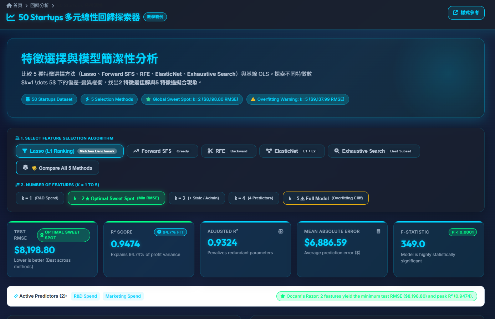

# 50 Startups：多元線性回歸與特徵選擇範例



**🔗 GitHub 倉庫：** [samson8423-job/AIoT-DIC2](https://github.com/samson8423-job/AIoT-DIC2)

**🌐 線上演示：** [https://samson8423-job.github.io/AIoT-DIC2/](https://samson8423-job.github.io/AIoT-DIC2/)

此專案為教學範例，示範如何比較多種特徵選擇方法（Lasso、Forward SFS、RFE、ElasticNet、Exhaustive）在 50 Startups 資料集上的預測表現，並以互動式網頁介面展示模型結果與診斷。

## 快速開始（中文）

### 🌐 線上使用（推薦）
直接瀏覽 GitHub Pages 版本：[https://samson8423-job.github.io/AIoT-DIC2/](https://samson8423-job.github.io/AIoT-DIC2/)

### 💻 本機開發（可選）

1. 克隆倉庫並安裝依賴：

```bash
git clone https://github.com/samson8423-job/AIoT-DIC2.git
cd AIoT-DIC2
pip install -r requirements.txt
```

2. 啟動 Flask 開發伺服器（用於本機開發）：

```bash
python app.py
# 然後開啟瀏覽器：http://localhost:5000/
```

3. 或直接用瀏覽器打開 `index.html`（靜態版本）：

```bash
# Windows
start index.html

# macOS
open index.html

# Linux
xdg-open index.html
```

## 主要檔案說明
- `app.py`：Flask 應用與簡單 REST API（`/api/models`, `/api/predict`, `/api/summary`）。
- `templates/index.html`：Jinja2 範本（前端頁面）。
- `static/model_data.js`、`model_data.json`：前端使用的靜態模型結果資料。
- `main.py`：CRISP‑DM 流程的訓練腳本，會輸出比較表格、圖檔與 top10 outliers。

## 如何重新訓練模型（選做）

1. 下載資料並執行訓練：

```bash
python main.py
```

此腳本會在專案目錄產生圖表與 CSV 結果（例如 `feature_selection_comparison.csv`、`top10_outliers.csv` 等）。若要把訓練結果轉成前端使用的 `model_data.json`（或 `static/model_data.js`），目前專案未內建自動轉換腳本；我可以協助您新增一支小工具來將 `main.py` 的輸出轉為 `model_data.json`，或直接將新的 JSON 寫入 `static/model_data.js` 以供前端載入。

## API 快速參考
- `GET /api/models`：取得所有算法、各 k 的結果（若提供 `?algo=Lasso` 則回傳單一算法）。
- `POST /api/predict`：以 JSON 提交輸入，回傳預測值與各項貢獻拆解。例如：

```json
{
   "algo": "Lasso",
   "k": 2,
   "rd_spend": 100000,
   "marketing_spend": 150000,
   "admin_spend": 120000,
   "state": "California"
}
```

## 使用修改建議（我可以代勞）
- 將前端介面改為中文化（我已示範部分修改）。
- 若要完全換新排版（例如卡片式、深色主題或更簡潔的報表），我可以修改 `templates/index.html` 與對應 CSS。 
- 若要把 `main.py` 的訓練結果自動匯出為 `model_data.json`，我可以幫您新增一個小 script 並示範如何執行。

## 部署
- 此專案可部署為靜態前端（`index.html` + `static`）或使用 Flask/Serverless（`api/index.py`）部署至 Vercel。也可直接使用 GitHub Pages 部署靜態版本。

如果您要我幫忙：
- 將整個前端中文化與重新排版
- 或是執行一次模型重訓並把新結果塞回 `static/model_data.js`

請告訴我您優先要我做哪一項，我會繼續處理。
- **Minimum Test RMSE**: **`$8,198.80`** (lowest error across all tested models)
- **Peak Test $R^2$**: **`0.9474`** (explains 94.74% of startup profit variation)
- **R&D Dominance**: Alone, R&D spend accounts for over $94.6\%$ of profit variation ($k=1$: $R^2 = 0.9465$, $\text{RMSE} = \$8,274.87$). Adding Marketing Spend provides complementary positive predictive lift.

### 2. The 5-Feature Overfitting Cliff ($k=5$)
Adding redundant variables (`Administration` and location dummies `State_Florida`, `State_New York`) introduces noise and multicollinearity:
- **Test RMSE Spikes**: from **`$8,198.80`** to **`$9,137.99`** ($+\$939$ penalty!)
- **$R^2$ Degrades**: drops to **`0.9347`**
- **Principle of Parsimony (Occam's Razor)**: The simpler 2-variable model outperforms the full 5-variable model in predictive accuracy, interpretability, and generalizability.

---

## 🔬 Comparison of the 5 Feature Selection Algorithms

All 5 methods were benchmarked across $k=1 \dots 5$ features on the out-of-sample test set:

| Feature Selection Algorithm | $k=1$ (RMSE) | $k=2$ (RMSE) | $k=3$ (RMSE) | $k=4$ (RMSE) | $k=5$ (RMSE) | Best Feature Subset |
| :--- | :---: | :---: | :---: | :---: | :---: | :--- |
| **Lasso (L1 Ranking)** | $8,274.87 | **$8,198.80** | $8,309.06 | $8,409.92 | $9,137.99 | `['R&D Spend', 'Marketing Spend']` |
| **Forward SFS** | $8,274.87 | **$8,198.80** | $8,803.78 | $8,997.20 | $9,137.99 | `['R&D Spend', 'Marketing Spend']` |
| **RFE** | $8,274.87 | **$8,198.80** | $8,803.78 | $9,068.54 | $9,137.99 | `['R&D Spend', 'Marketing Spend']` |
| **ElasticNet Ranking** | $8,274.87 | **$8,198.80** | $8,803.78 | $8,997.20 | $9,137.99 | `['R&D Spend', 'Marketing Spend']` |
| **Exhaustive (Best Subset)** | $8,274.87 | $8,198.80 | **$8,171.65** | $8,178.37 | $9,137.99 | `['R&D Spend', 'Admin', 'State_FL']` |

---

## 📁 Repository Structure

```text
├── dashboard_demo.png                  # Dashboard screenshot in README
├── app.py                              # Flask Web Application (WSGI entrypoint & REST API)
├── api/
│   └── index.py                        # Vercel Serverless Function entry point
├── templates/
│   └── index.html                      # StatsUnlock-style Jinja2 web template
├── static/
│   └── model_data.js                   # Static data asset for instant frontend fallback
├── model_data.json                     # Comprehensive model statistics, weights, and tests
├── vercel.json                         # Vercel deployment configuration
├── requirements.txt                    # Project dependencies (Flask, NumPy, Pandas, etc.)
├── main.py                             # CRISP-DM CLI multiple linear regression script
├── feature_progression_analysis.py     # Script generating k=1..5 metrics and charts
├── all_5_algorithms_comparison_plot.png# Comparison chart of all 5 algorithms
└── README.md                           # Documentation and project manual
```

---

## ☁️ Deployment

### 1. GitHub Repository (Active)
🔗 **[https://github.com/samson8423-job/AIoT-DIC2](https://github.com/samson8423-job/AIoT-DIC2)**
Main repository for feature selection and multiple linear regression analysis.

### 2. Vercel
Configured for zero-config Vercel Python serverless deployment via `api/index.py` and `vercel.json`.

---

## 🙏 Acknowledgments & References

We gratefully acknowledge the following references, datasets, and open-source tools:

1. **Design & Layout Reference**:
   - [StatsUnlock Multiple Linear Regression Calculator](https://statsunlock.com/multiple-linear-regression-calculator/): Inspired the SaaS aesthetic, coefficient tables, VIF multicollinearity gauges, and statistical reporting layout.
2. **Dataset**:
   - [50 Startups Dataset (Avik Jain 100-Days-Of-ML-Code)](https://raw.githubusercontent.com/Avik-Jain/100-Days-Of-ML-Code/master/datasets/50_Startups.csv).
3. **Core Libraries**:
   - [Flask](https://flask.palletsprojects.com/): Python micro web framework.
   - [Scikit-learn](https://scikit-learn.org/): For LassoCV, ElasticNetCV, SequentialFeatureSelector, and RFE.
   - [Statsmodels](https://www.statsmodels.org/): For OLS inference, $t$-tests, $p$-values, confidence intervals, and VIF calculations.
   - [Chart.js](https://www.chartjs.org/): For responsive, interactive dual-panel line charts.
